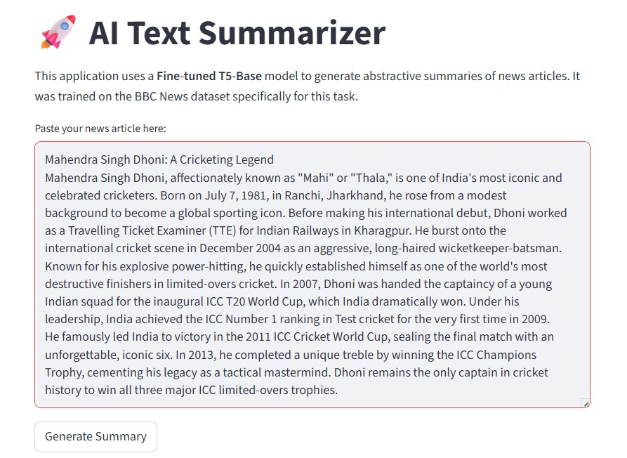
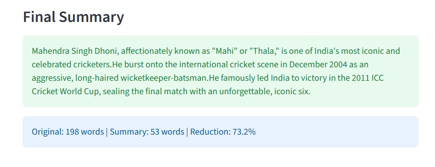

# Abstractive Text Summarizer

An abstractive news summarizer built by fine-tuning Google's pre-trained **T5-base** transformer on the **BBC News Summary** dataset, with a **Streamlit** web app. Paste a news article, and the app writes a short summary in its own words and shows how much shorter it is.

B.Tech Electronics and Communication Engineering final-year project, Techno India University, Kolkata (session 2025-2026).

## Demo

Paste an article and click **Generate Summary**:



The app returns the summary and the word-count reduction:



In this example, a 198-word article was condensed to a 53-word summary (73.2% shorter).

## How it works

1. **Data:** 2,225 news article and human-written summary pairs from the BBC News Summary dataset, covering business, entertainment, politics, sport, and tech.
2. **Preprocessing:** each article gets the `summarize:` prefix that T5 expects, then is tokenized with the T5 SentencePiece tokenizer (inputs up to 512 tokens, summaries up to 150 tokens).
3. **Fine-tuning:** T5-base (about 220 million parameters) is trained on a 90% / 10% train/test split with the Hugging Face `Seq2SeqTrainer`.
4. **Inference:** the app generates summaries with beam search and returns the cleaned text.

### Training settings

| Setting | Value |
|---|---|
| Base model | `t5-base` |
| Epochs | 3 |
| Learning rate | 2e-5 |
| Weight decay | 0.01 |
| Batch size | 4 |
| Precision | FP16 (mixed precision) |
| Train / test split | 90% / 10% |

### Summary generation settings (in the app)

| Setting | Value |
|---|---|
| Beam search | 4 beams |
| Length | 40 to 120 tokens |
| `no_repeat_ngram_size` | 3 |
| `length_penalty` | 1.5 |

## Tech stack

Python, PyTorch, Hugging Face Transformers, Hugging Face Datasets, SentencePiece, Pandas, Streamlit, Google Colab.

## Project structure

```
abstractive-text-summarizer/
├── app.py                    # Streamlit web app
├── training_notebook.ipynb   # Fine-tuning notebook (run on Google Colab)
├── requirements.txt          # Libraries needed to run the app
├── app-input.png             # App screenshot (input)
├── app-output.png            # App screenshot (output)
└── README.md
```

## Getting started

The trained model is **not included** in this repository, because it is close to 1 GB and too large for GitHub. You need the model folder before the app can run.

### 1. Get the model

**Option A: train it yourself (Google Colab, free GPU)**
1. Download the *BBC News Summary* dataset from Kaggle as `archive.zip`.
2. Open `training_notebook.ipynb` in Google Colab, choose **Runtime > Change runtime type > GPU**, and upload `archive.zip`.
3. Run all cells. The model is saved to your Google Drive as `BTech_Project_Model`.
4. Download that folder and place it next to `app.py`.

**Option B: use a model hosted on the Hugging Face Hub**
Upload the trained model folder to a Hugging Face model repository, then set the `MODEL_ID` environment variable to its id:

```
# Windows (PowerShell)
$env:MODEL_ID="your-username/your-model-name"

# Mac / Linux
export MODEL_ID="your-username/your-model-name"
```

### 2. Install and run the app

```
pip install -r requirements.txt
streamlit run app.py
```

Then open the local address that Streamlit prints (usually http://localhost:8501).

## Limitations

- The model was fine-tuned only on BBC news articles, so it works best on English news-style text. Other kinds of text may give weaker summaries.
- Inputs longer than 512 tokens are truncated, so very long articles are summarized from their opening part only.
- Like other abstractive models, it can occasionally produce wording that is not in the original article. Check important facts against the source.
- Running on CPU is slow. A GPU gives much faster results.

## Team

- Kritika Chandravanshi
- Kunal Vats
- Rohan Kumar Mahato
- Nitesh Mahato

**Supervisor:** Pritam Som, Associate Professor, Department of ECE, Techno India University

## Acknowledgements

- [Google T5](https://huggingface.co/google-t5/t5-base) for the pre-trained model
- Hugging Face for the Transformers and Datasets libraries
- The BBC news dataset collected by Greene and Cunningham (2006), used here through the BBC News Summary version on Kaggle
